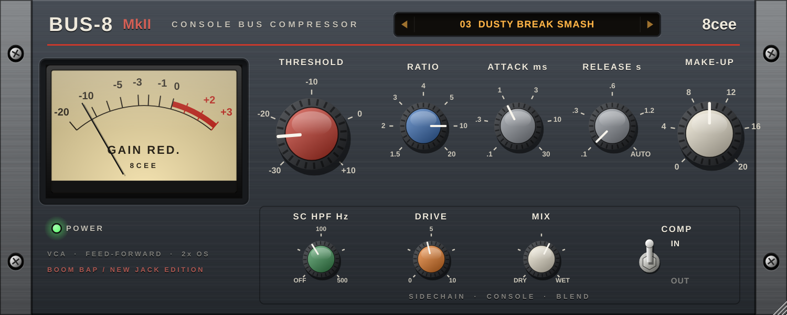

# 8cee Bus-8 MkII — Console Bus Compressor



A console-style VCA bus compressor by **8cee**, voiced for 90s NY boom bap and new jack swing. VST3 on Windows and macOS, plus AU and standalone apps on macOS. Built with JUCE.

## Controls

| | |
|---|---|
| **Threshold** | −30 to +10 dB |
| **Ratio** | 1.5 / 2 / 3 / 4 / 5 / 10 / 20 |
| **Attack** | .1 / .3 / 1 / 3 / 10 / 30 ms — 10 and 30 let the kick and snare transient through before it clamps (the classic drum bus punch) |
| **Release** | .1 / .3 / .6 / 1.2 s or **AUTO** — two-stage: fast after hits, slower when the whole bus is being squeezed |
| **Make-Up** | 0 to +20 dB |
| **SC HPF** | Off to 500 Hz, continuous. Keeps the kick and bass from pumping the whole bus |
| **Drive** | Console line-amp grit before the compressor: asymmetric saturation with even harmonics, level-compensated so it adds grit, not volume |
| **Mix** | Dry to wet, for parallel (NY-style) compression |
| **Comp In/Out** | Bypasses the compressor only, so you can compare the same drive with and without compression |

Linked stereo, feed-forward detection. The whole signal path runs 2× oversampled, so the drive doesn't alias and dry/wet stay phase-aligned. The meter shows gain reduction. The faceplate is resizable (50–200 %); double-click any knob to reset it.

## Presets

Click the amber display for the menu, or step through with its arrows or the mouse wheel. A `*` means you've tweaked it since loading; the menu then offers "Revert". Your DAW sees them as programs too, and your own settings are saved with the project.

| 90s NY Boom Bap | New Jack Swing | R&B | Mix & Master |
|---|---|---|---|
| Boom Bap Drum Bus, Dusty Break Smash, SP Grit Glue, NY Parallel Crush, Knock Pump, Loop Chop Pump, Boom Bap Mix Bus | New Jack Drum Glue, Swing Beat Punch, Gated Snare Crack, Kick & Bass Lock, Jack Swing Mix Bus | R&B Vocal Bus | Gentle 2-Bus Glue, Init |

The thresholds assume a bus peaking around −6 dBFS. Start from a preset, then move **Threshold** until the meter shows the gain reduction you want.

## Download a build

Every push runs `.github/workflows/build.yml` on GitHub: it builds Windows and macOS (Apple Silicon + Intel), checks the plug-in with **pluginval**, and puts a zip under **Actions → Build plug-ins → (latest run) → Artifacts**.

## Install

| | Windows | macOS |
|---|---|---|
| VST3 | `C:\Program Files\Common Files\VST3\` | `~/Library/Audio/Plug-Ins/VST3/` |
| AU | — | `~/Library/Audio/Plug-Ins/Components/` |

Then rescan plug-ins in your DAW (in MPC: Preferences → Plugins → Rescan).

## Build it yourself

You need CMake 3.22+ and a C++17 compiler (Visual Studio 2022 on Windows, Xcode on macOS). JUCE 8.0.4 is downloaded automatically.

```bash
cmake -S . -B build -DCMAKE_BUILD_TYPE=Release
cmake --build build --config Release --parallel
```

## Project layout

```
shared/          DSP helpers, processor base with the preset system, vector UI kit (shared with 8cee Vintage)
plugins/Bus8MK2  processor, faceplate and factory presets
tools/           dev-only: renders the UI to PNG and prints a level/THD/preset report (-DECEE_BUILD_TOOLS=ON)
```

## Before you sell it

JUCE 8 is dual-licensed (AGPLv3 or a JUCE licence). Selling a closed-source plug-in needs a JUCE licence; the free Starter tier covers small revenue. Check juce.com for the current terms. Keep "SSL" and other manufacturers' names out of the product name and marketing.
